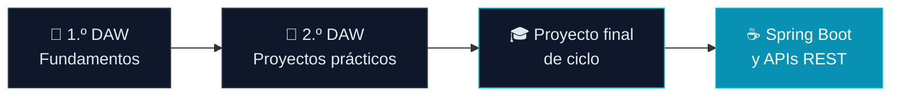

<div align="center">


<br/><br/>

<a href="https://sergio-marino-estevez.vercel.app"></a>
<a href="mailto:sermaes2007@gmail.com"></a>


</div>

---

## 👨‍💻 Perfil Profesional

Estudiante de último curso del Ciclo Formativo de Grado Superior en **Desarrollo de Aplicaciones Web (DAW)**. Orientado al desarrollo de software con especial interés en la programación **Orientada a Objetos**, arquitectura Backend con **Java** y construcción de interfaces web funcionales.

Actualmente enfocado en consolidar buenas prácticas de código y patrones de diseño, y en prepararme para la incorporación al mercado laboral a través de proyectos prácticos y la finalización del ciclo formativo.

> 🌐 **Echa un vistazo a mi portfolio:** [sergio-marino-estevez.vercel.app](https://sergio-marino-estevez.vercel.app)

---

## 🧠 Formación y Competencias

```javascript
const sergioMarino = {
  titulacion: "Técnico Superior en Desarrollo de Aplicaciones Web (En curso - 2.º año)",
  especialidades: ["Desarrollo Backend", "Desarrollo Frontend", "Bases de Datos"],
  lenguajesPrincipales: ["Java", "JavaScript", "HTML5", "CSS3", "SQL"],
  frontend: ["React", "Next.js", "Tailwind CSS", "TypeScript"],
  entornosYHerramientas: ["Git", "GitHub", "IntelliJ IDEA", "VS Code"],
  interesesProfesionales: [
    "Arquitectura de software",
    "Desarrollo de APIs REST",
    "Persistencia de datos y bases de datos relacionales"
  ]
};
```

---

## 🛠️ Tecnologías y Herramientas

<div align="center">

**Lenguajes y Desarrollo Web**


**Bases de Datos, Control de Versiones y Entornos**


</div>

---

## 🎯 Estado Académico y Objetivos



- **Estado actual:** Finalizando el 2.º curso de DAW.
- **Objetivo a corto plazo:** Realización del proyecto final de ciclo y aplicación de conocimientos en un entorno real de trabajo.
- **Áreas de aprendizaje continuo:** Profundización en frameworks backend (Java/Spring Boot) y consumo de servicios web.

---

## 📊 Actividad en GitHub

<div align="center">


<br/>


</div>


